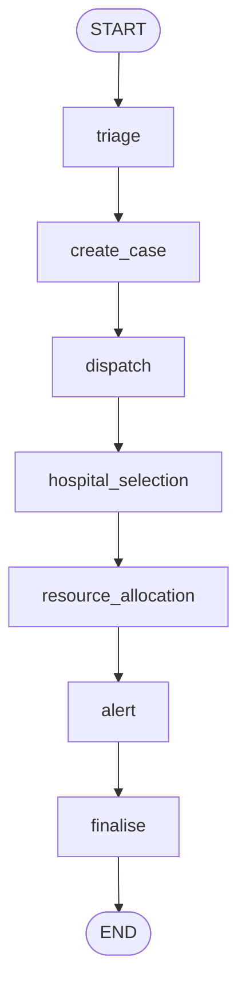

#  PulseGrid: Agentic Emergency Dispatch & Resource Routing System

PulseGrid is a polished command, triage, and routing console for emergency medical services. It combines a real-time React web application with a multi-agent backend workflow powered by **LangGraph**, **LangChain**, and the **Groq Llama 3** model. It coordinates ambulance dispatch, hospital resource allocation, and live incident operations in one interface.

---

## Project Features

*   **Role-Based Access Control (RBAC)**: Tailored dashboards, workflows, and action items custom-scoped for **Admins/Dispatchers**, **Hospital Staff**, and **Ambulance Crews**.
*   **Dynamic Multi-Agent Routing**: A coordinated LangGraph workflow executing sequence-dependent clinical operations (triage, dispatch, allocation) in a unified state.
*   **Conversational Interface**: A natural-language chat assistant supporting scoped commands (e.g., "Assign ambulance 2 to case 5", "Update hospital 1 ICU beds by +3") with automatic permission gates.
*   **Atomic Resource Bookings**: Secure SQLite transaction validation preventing race conditions or double-booking of critical supplies (ICU beds, regular beds, ventilators).
*   **WebSocket Event Syncing**: Real-time server-client telemetry pushing live alerts and coordinate updates instantly across dashboards.
*   **Fail-Safe Graceful Fallbacks**: Gracefully switches to deterministic, local rule-based heuristics if the external LLM provider is down or offline.

---

## Agents Used

The system utilizes six specialized, role-focused AI agents:

1.  **Triage Agent** (triage_agent.py)
    *   **Role**: Evaluates raw, unstructured emergency logs (patient symptoms/details).
    *   **Output**: Determines the case condition and assigns a clinical severity level from **P0** (highest) to **P3** (lowest).
2.  **Dispatch Agent** (dispatch_agent.py)
    *   **Role**: Selects the initial combination of nearest available ambulance and optimal target hospital.
    *   **Mechanism**: Uses heuristic ranking formulas based on geographic coordinate distances, bed availability, and ICU status.
3.  **Hospital Selection Agent** (hospital_selection_agent.py)
    *   **Role**: Validates the selected hospital against strict clinical requirements.
    *   **Constraint Enforcement**: Enforces hard filters such as specialty matching (e.g., Cardiology for chest pain, Trauma Care for accidents) and resource capabilities (ICU/ventilators for P0/P1 cases).
4.  **Resource Allocation Agent** (resource_allocation_agent.py)
    *   **Role**: Allocates medical hardware and beds to incoming patient profiles.
    *   **Mechanism**: Issues reservation entries in the SQLite database and executes atomic resource decrements to prevent double-booking.
5.  **Alert Agent** (alert_agent.py)
    *   **Role**: Prepares and routes emergency alerts to target facilities and staff.
6.  **Chat Agent** (chat_agent.py)
    *   **Role**: Powers the live conversational UI, parsing natural language statements into command tool invocations (e.g., reserving resources, updating coordinates).

---

## Agent Pipeline & Workflow

PulseGrid operates on a linear LangGraph `StateGraph` workflow that manages the step-by-step progress of an emergency incident from inception to dispatch confirmation.

### 1. `triage` Node
*   The `TriageAgent` parses incoming patient logs.
*   Assigns a priority category (**P0**, **P1**, **P2**, or **P3**).

### 2. `create_case` Node
*   Creates a `Case` instance in the database using the triaged parameters.
*   Initializes status tracker and coordinates log entries.

### 3. `dispatch` Node
*   The `DispatchAgent` gathers idle ambulances and hospitals.
*   Identifies the optimal pair (closest ambulance and high-scoring hospital) using custom soft-scoring heuristics.

### 4. `hospital_selection` Node
*   The `HospitalSelectionAgent` acts as a guardrail. 
*   Validates the chosen hospital's medical capacity and specialty list. If the dispatch choice violates hard constraints, the agent overrides it and routes the patient to a fully-equipped fallback facility.

### 5. `resource_allocation` Node
*   The `ResourceAllocationAgent` reserves the required slots (e.g., an ICU bed and ventilator for P0) in the `Resource` and `Reserved` tables.
*   Applies database transaction scopes to guarantee consistency.

### 6. `alert` Node
*   The `AlertAgent` formats dispatch details into notifications sent to the designated ambulance and hospital.

### 7. `finalise` Node
*   Saves final telemetry, changes case status from `triaged` to `discharged` or `assigned`, and closes the pipeline execution.

---

## Tech Stack

*   **Backend**: Flask (Python), Flask-SQLAlchemy (SQLite database), Flask-SocketIO (Real-time updates), LangGraph, LangChain, Groq LLM API.
*   **Frontend**: React (Vite), TailwindCSS, React-Leaflet (Maps), Zustand (State management), Axios.
